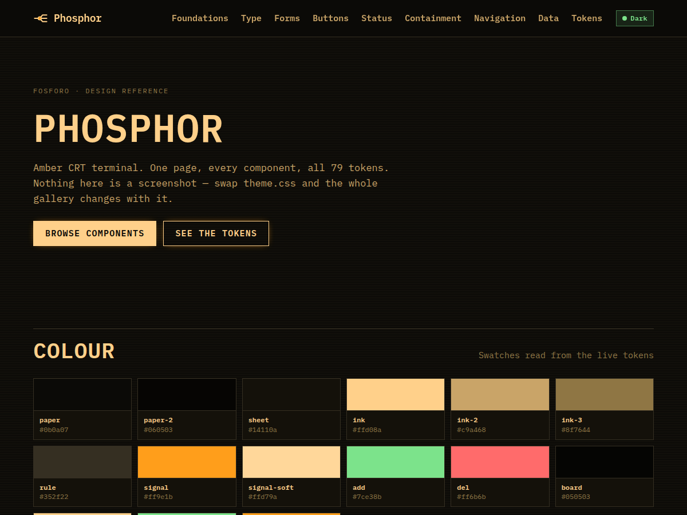

# Phosphor — design reference

**Amber CRT terminal**

One page showing every component in this design, rendered from its own design
tokens. No build step, no dependencies: open `index.html`.

**[View the component gallery →](https://mawentory.github.io/design-fosforo/)**



## What is here

| File | Purpose |
| --- | --- |
| `index.html` | Component gallery — every component on one page |
| `DESIGN.md` | The design notes: origin, palette, type, shape, measured contrast |
| `theme.css` | The 66 design tokens, plus derived accessibility values |
| `design.css` | Component styles, written against tokens only |
| `fonts.css` | `@font-face` declarations for the fonts this design uses |
| `fonts/` | Latin-subset woff2 files, self-hosted |

`design.css` contains no colour, radius or font literal. That is deliberate: the
same stylesheet drives all ten designs and only `theme.css` differs, so the
gallery doubles as a test that the token set is complete.

## The design

Amber phosphor monitors: near-black glass, warm glowing glyphs, and the faint horizontal banding of a scanline.

**Type** — IBM Plex Mono throughout, including body copy. The monospace grid is the point of the design, not a limitation of it.

**Shape** — 1px hairlines and 2px radii. Panels read as frames drawn on a terminal, and the only motion is a glow.

**Signature moves**

- Scanline texture from a 3px repeating gradient.
- A drop-shadow glow on code blocks and the chart.
- Monospace body copy on a ~1.6 line height for legibility.

## Colour

| Token | Value | Role |
| --- | --- | --- |
| `--paper` | `#0b0a07` | Page ground |
| `--sheet` | `#14110a` | Raised surfaces |
| `--ink` | `#ffd08a` | Primary text |
| `--signal` | `#ff9e1b` | Action |
| `--signal-text` | `#ff9e1b` | Action, when it has to be read |
| `--focus-ring` | `#ff9e1b` | Focus indicator |

## Accessibility

Every colour pair this design can render as text is checked against WCAG 2.1
when the repo is generated — page surfaces, panel surfaces, and the tinted fills
of badges and diff lines. The full table is in
[DESIGN.md](DESIGN.md#contrast-measured); the gallery is separately audited in a
real browser for heading order, duplicate ids, unlabelled controls and
horizontal overflow at 1280px and 390px.

## Using it

Set the theme attribute on your root element and load the two stylesheets:

```html
<html data-theme="fosforo">
  <link rel="stylesheet" href="fonts.css" />
  <link rel="stylesheet" href="theme.css" />
  <link rel="stylesheet" href="design.css" />
</html>
```

Because the tokens are namespaced by attribute, this theme can sit alongside
another one in the same page.

## The rest of the set

[Placa](https://github.com/mawentory/design-placa), [Blueprint](https://github.com/mawentory/design-blueprint), [Press](https://github.com/mawentory/design-imprensa), [Swiss](https://github.com/mawentory/design-suico), [Neon](https://github.com/mawentory/design-neon), [Brutalist](https://github.com/mawentory/design-brutalista), [Botanical](https://github.com/mawentory/design-botanico), [Bauhaus](https://github.com/mawentory/design-bauhaus), [Vidro](https://github.com/mawentory/design-vidro).

---

Part of the MarvinRouter design set. Generated from a single template; see
`DESIGN.md` for the values behind it.
